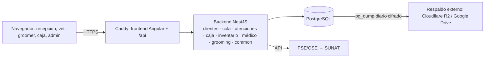
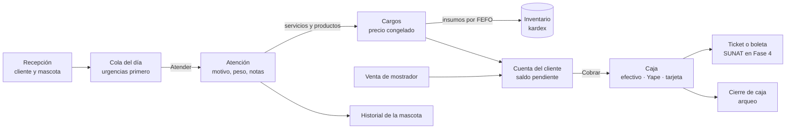

# Plan de desarrollo — Sistema veterinario

> Plan actualizado el 28 de octubre de 2026. Este archivo es la versión vigente.
>
> **Estado:** Fases 0, 1 y 2 terminadas. **Fase 3 (Atención y cobro) en curso:** pasos 0, 1 y 2 listos en backend (correlativos y aislamiento; atenciones y cargos; caja con sesiones y arqueo, cobros mixtos y parciales sin duplicados, venta de mostrador a "Cliente varios", egresos, anulación con devolución, ticket NV y reporte). Entorno de desarrollo completo en Docker. Sigue el paso 3: pantallas de atención. Pendiente de la Fase 0: desplegar en un servidor de prueba (hito de demo).

Construimos el sistema en 9 fases alrededor de un solo circuito: **llega → espera → se atiende → se cobra → queda en el historial**. Cada fase agrega algo a ese circuito o lo hace más completo, y termina con algo que una clínica real puede usar. Primero se cierra el circuito completo de forma simple (Fase 3) y después se profundiza cada parte: comprobantes SUNAT, historia clínica, grooming y reportes.

## 1. Objetivo

- **Qué se construye:** un sistema de gestión veterinaria SaaS para clínicas en Perú. Módulos: dashboard, clientes y mascotas, módulo médico (citas, SOAP, recetas, vacunas), grooming, inventario farmacéutico con lotes, y caja con boletas y facturas.
- **Quién lo usa:** recepción, veterinarios, bañadores y peluqueros, cajeros y el administrador de la clínica. Cada uno ve solo lo que le toca según su rol.
- **Qué se espera al final:** un producto vendible a clínicas y, al mismo tiempo, un proyecto de portafolio que muestre dominio full-stack.
- **Restricciones:** Angular 22 + Tailwind CSS (sin Bootstrap ni librerías de componentes pesadas), NestJS en el backend, servicios `.service.ts` separados de los componentes, Reactive Forms con validaciones, y cobro con QR de Yape sin pasarela de pago.
- **Equipo:** un solo desarrollador. Por eso el orden de las fases importa más que la cantidad de funciones.

## 2. Tecnologías recomendadas

Recomiendo Angular 22 + Tailwind 4 en el frontend y NestJS + Prisma + PostgreSQL en el backend: todo en TypeScript, en un solo repositorio con Docker. Es el mismo stack de tu ERP Mayorista, así que reutilizas lo que ya resolviste (multi-tenant, kardex, facturación) y avanzas más rápido trabajando solo. Spring Boot quedó descartado: es más lento de construir para una persona y pide el doble de memoria en el servidor.

| Capa | Recomendado | Por qué |
| --- | --- | --- |
| Frontend | Angular 22 (standalone, signals, sin zone.js) | Las versiones nuevas son más simples y rápidas que la estructura antigua de módulos |
| Estilos | Tailwind CSS 4 + fuentes con @fontsource | Diseño propio sin Bootstrap; las fuentes viven dentro del proyecto |
| Interacciones | Angular CDK (drag and drop, overlays) | Oficial y liviano: sirve para el Kanban de grooming y los modales |
| Formularios | Reactive Forms | Validaciones claras (DNI de 8 dígitos, RUC de 11) |
| Gráficos | Chart.js | Liviano y suficiente para los KPIs del dashboard |
| Iconos | Lucide (registro local de SVG) | Sin dependencia extra; ya está armado |
| Backend | NestJS 12 sobre Node 24 LTS (TypeScript) | Un solo lenguaje en todo el proyecto, el mismo de tu ERP Mayorista, y poca memoria en el servidor |
| Datos | PostgreSQL + Prisma 7 | Transacciones con bloqueo de filas (`SELECT … FOR UPDATE`) para el stock FEFO |
| Migraciones | Prisma Migrate | Cada cambio de la base de datos queda versionado en el repo |
| API | DTOs con class-validator + Swagger (@nestjs/swagger) | Validación en el servidor y documentación para probar |
| Seguridad | JWT con roles (guards de NestJS) y contraseñas con bcrypt | Roles: admin, veterinario, recepción, groomer y cajero |
| Tiempo real | Consulta periódica primero; luego Server-Sent Events | El Kanban se actualiza sin agregar WebSockets desde el inicio |
| Pruebas | Pruebas unitarias + PostgreSQL real para FEFO · Vitest en Angular · Playwright | FEFO probado contra la base real; flujos completos de punta a punta |
| Infraestructura | Docker Compose + GitHub Actions | Mismo entorno en tu PC y en el servidor; pruebas automáticas en cada push |
| Despliegue | Un VPS económico (Contabo o Hostinger) de US$ 6–7 al mes con todo dentro | Suficiente para una clínica pequeña; Lightsail cuando haya varias |
| Comprobantes | Impresión de ticket con CSS desde el navegador; boleta y factura electrónicas por un PSE/OSE | Funciona sin impresora especial; SUNAT se integra por API en la Fase 4 |

Evita Angular Material y Bootstrap (pelean con Tailwind) y los `NgModule` nuevos.

### Despliegue para una veterinaria pequeña

Para la primera clínica basta un VPS económico de unos US$ 6–7 al mes, con todo adentro y un respaldo diario fuera del servidor. Cuando haya varias clínicas pagando, se pasa a Lightsail o a un plan más grande.

- **Servidor:** [Contabo Cloud VPS 10](https://www.whtop.com/plans/contabo.com/133001) (3 vCPU, 75 GB NVMe; €4.40 al mes el primer periodo y €5.50 al renovar, según [cambios de 2026](https://pricingsaas.com/companies/contabo.main/diffs/2026Q2)) o [Hostinger KVM 1](https://www.vpsbenchmarks.com/hosters/hostinger/plans/kvm-1) (4 GB de RAM; US$ 6.99 al mes el primer año con contrato anual, luego unos US$ 12.99). Hostinger tiene panel y soporte en español; Contabo sale más barato al renovar.
- **Dentro del servidor (Docker Compose):** PostgreSQL, el backend NestJS (unos 200 MB de memoria) y Caddy. Caddy sirve el frontend compilado, redirige `/api` al backend y renueva el certificado HTTPS solo, gratis.
- **Respaldo externo, obligatorio:** un `pg_dump` diario cifrado se copia a Cloudflare R2 o Google Drive y se guardan 30 días. Una vez al mes se prueba restaurar. Los VPS baratos no garantizan sus propias copias.
- **Monitoreo:** un chequeo gratuito de disponibilidad (por ejemplo, UptimeRobot) que te avisa si el sistema se cae, antes de que llame la clínica.
- **Dominio:** un `.com`, aproximadamente US$ 10–15 al año.
- **Internet de la clínica:** si se cae el internet, se cae el sistema. Lo práctico es tener un respaldo con datos móviles (un router 4G o el celular como punto de acceso).

| Opción | Costo mensual aprox. | Cuándo usarla |
| --- | --- | --- |
| Contabo Cloud VPS 10 | €4.40–5.50 | Primera clínica, al menor costo a largo plazo |
| Hostinger KVM 1 | US$ 6.99 el primer año, ~US$ 12.99 después | Si prefieres panel y soporte en español |
| AWS Lightsail 2 GB | US$ 12 + ~US$ 3 de snapshots | Varias clínicas, o cuando la estabilidad pesa más que el precio |
| Oracle Always Free | Gratis | Solo demo y portafolio: en junio de 2026 [redujo sus límites](https://infoq.com/news/2026/07/oracle-cloud-free-tier-limits/) sin aviso |

No uses planes gratuitos para una clínica en uso. Un servidor dentro de la clínica ahorra la mensualidad, pero te deja a cargo de apagones, robos y respaldos. Cobra a la clínica una mensualidad que cubra el servidor y tu soporte.

## 3. Decisiones y supuestos

Las tres decisiones de fondo ya están tomadas.

**Decisiones**

1. **Proyecto (resuelta):** repositorio nuevo, UywaSys, en `H:\uywasys`, con `frontend/` y `backend/`. No se reutiliza código de Petclinic. Nombre comercial: Uywa.
2. **Comprobantes electrónicos (resuelta):** sí, desde el primer día. La mayoría de contribuyentes está obligada y una nota de venta no es un comprobante válido, así que la integración con un PSE/OSE entra en la Fase 4.
3. **Una o varias clínicas (resuelta):** base preparada para varias. Cada tabla lleva `clinic_id` desde el inicio, aunque se empiece con una sola clínica.
4. **Circuito primero (resuelta, 28 de octubre):** con clientes, cola e inventario listos, los módulos funcionaban como islas: la cola terminaba en "Atendido" sin registrar qué se hizo ni cuánto se cobró. Por eso la Fase 3 pasa a ser **Atención y cobro**, que conecta todo, y grooming baja a la Fase 6. Mientras no se integre SUNAT (Fase 4), el ticket dice "Nota de venta interna — no es comprobante de pago": sirve para pruebas y demos, pero no se le entrega el sistema a una clínica sin la Fase 4.

**Supuestos** (se corrigen si no aplican)

- [Supuesto] Una clínica con una sede al inicio, pero las tablas llevan `clinic_id` para no cerrar la puerta a varias.
- [Supuesto] Base de datos PostgreSQL y zona horaria America/Lima para todas las fechas.
- [Supuesto] Yape se cobra con el QR fijo de la clínica: el cajero confirma el pago en su app y registra el código de operación. Sin una pasarela no existe confirmación automática.

**Cambios que propongo a la especificación de grooming e inventario**

- `groomerName` como texto pasa a ser un empleado (`Staff`) con su porcentaje de comisión. Con texto libre, "José" y "jose" serían dos personas distintas al calcular comisiones.
- `paid` deja de ser un sí/no que se marca a mano: el servicio de grooming genera un cargo en la cuenta del cliente y queda pagado cuando caja lo cobra.
- Se agrega una tabla de movimientos de stock (kardex). Sin ella no se sabe qué lote se vendió, a quién ni cuándo, y no se puede anular una venta devolviendo las unidades a su lote.

## 4. Arquitectura

Una aplicación Angular habla con un solo backend NestJS organizado por módulos de negocio, sobre una sola base PostgreSQL. No hacen falta microservicios: un monólito ordenado es más rápido de construir y de desplegar para un solo desarrollador.



Atenciones, caja, el módulo médico y la merma interna nunca tocan los lotes directamente: siempre llaman a `StockService.deduct` dentro de su propia transacción, así la regla FEFO vive en un solo lugar.

**Estructura del repositorio**

```text
uywasys/
├── backend/  (NestJS, un módulo por área de negocio)
│   ├── prisma/          schema.prisma y migraciones
│   ├── test/            pruebas e2e contra PostgreSQL real
│   └── src/
│       ├── auth/ users/ clinic/ audit/     Fase 0
│       ├── clients/ pets/ queue/           Fase 1
│       ├── inventory/ care-services/       Fase 2
│       ├── visits/                         Fase 3: atenciones y cargos
│       ├── billing/                        Fase 3: cuenta, cobros y caja · Fase 4: SUNAT
│       ├── medical/ grooming/ dashboard/   Fases 5 a 7
│       └── common/       clínica activa (clinic_id), errores, Excel, fechas de Lima
├── frontend/ (Angular, una carpeta por módulo con carga diferida)
│   └── src/app/
│       ├── core/         layout, auth, interceptores, servicios HTTP y modelos
│       ├── shared/       ui (badge, modal, icon, pet-picker), utils
│       └── features/     dashboard, clients, queue, inventory, care-services, visits, cash…
└── docker-compose.yml   PostgreSQL para desarrollo
```

### El circuito de la clínica

Todo el sistema gira en torno a la **atención**: cada vez que una mascota recibe algo (consulta, vacuna, baño, una venta en mostrador) queda una atención con sus cargos. Los cargos se acumulan en la **cuenta del cliente** hasta que caja los cobra. Así nada se cobra "de palabra" y el historial se arma solo.



Las fases siguientes enriquecen piezas de este circuito sin cambiarlo: la Fase 4 convierte el ticket en boleta o factura, la Fase 5 convierte la atención en una consulta SOAP con receta, y la Fase 6 hace que el tablero de grooming genere sus propios cargos.

## 5. Plan por fases

El orden lo marcan las dependencias y el valor para la clínica. Clientes va primero porque todo lo usa; inventario antes de atención porque los servicios consumen insumos; la atención y la caja antes que SUNAT porque la boleta se emite sobre un cobro que ya existe; el módulo médico antes que grooming porque toda clínica necesita historia clínica y vacunas, mientras que el baño ya se puede cobrar desde la Fase 3 como un servicio más del catálogo.

| Fase | Qué entrega | Condición para pasar |
| --- | --- | --- |
| **0. Cimientos** ✅ | Repo, Docker Compose, PostgreSQL, Prisma y GitHub Actions. Login con roles, usuarios, configuración de la clínica y bitácora | El login funciona; el despliegue de prueba queda para el hito de demo |
| **1. Clientes y mascotas** ✅ | Clientes con DNI/RUC, mascotas con raza, sexo y alergias. Ficha, cola del día con urgencias e importación desde Excel | Recepción registra cliente y mascota en menos de 1 minuto |
| **2. Inventario farmacéutico** ✅ | Productos, lotes, presentaciones, kardex y conteo físico. FEFO, compras con proveedor, merma, semáforo de vencimientos, controlados, catálogo de servicios con insumos e importación desde Excel | Pasan las pruebas FEFO, incluida la de dos ventas simultáneas |
| **3. Atención y cobro** | Atender desde la cola, cargos de servicios y productos con descuento automático de insumos, cuenta del cliente con saldo, venta de mostrador, caja con apertura, cobros mixtos, pagos parciales, egresos y cierre con arqueo. Ticket interno, historial en la ficha y ventas del día en el dashboard | Un día completo de demo sin papel: recepción → atención → cobro → cierre de caja que cuadra |
| **Hito de demo** | Despliegue en un servidor de prueba (Docker Compose + Caddy + HTTPS), respaldo diario, datos de demostración y horarios de atención de la clínica | Se puede mostrar el sistema a una clínica desde su celular |
| **4. Comprobantes electrónicos** | Boleta y factura por PSE/OSE desde el cobro, notas de crédito, resumen diario y comunicación de baja, reintentos si el PSE no responde, series por clínica y reporte de ventas en Excel para el contador | SUNAT (en beta y luego en producción) acepta boletas, facturas y notas de crédito, y un PSE caído no frena la atención |
| **5. Módulo médico** | Agenda de citas por veterinario, consulta SOAP sobre la atención de la Fase 3, recetas que descuentan stock (con receta retenida para controlados), vacunas con refuerzo y carnet, adjuntos, consentimientos firmados en pantalla y presupuestos que se convierten en cargos | Una consulta completa, de la cita a la receta y al cobro, sin salir del sistema |
| **6. Grooming** | Check-in con checklist, Kanban por estados, delivery, constancia imprimible, botón de WhatsApp y comisiones por groomer. Cada servicio genera su cargo en la cuenta | Un día completo del área de baño se maneja solo con el tablero |
| **7. Dashboard y reportes** | KPIs del día y del mes, ventas por servicio y por veterinario, margen por producto, citas de hoy, alertas de stock y vencimientos, recordatorios de vacunas con enlace de WhatsApp | Cada número del dashboard coincide con su módulo de origen |
| **8. Comercialización** | Versión 2: hospitalización básica primero, luego compras, gastos y reservas en línea. Demo pública, página de venta y segunda clínica | Primera clínica usando el sistema (fase abierta: crece con los clientes) |

Cada fase se entrega por pasos: primero el backend con sus pruebas, luego las pantallas, y no se pasa a la siguiente fase sin cumplir su condición.

**La Fase 3 por pasos**

1. **Backend de atenciones y cargos:** abrir una atención desde la cola o desde la ficha, signos y notas, cargos de servicios y productos (los insumos se descuentan por FEFO en la misma transacción), anular un cargo devolviendo el stock a su lote, y la cuenta del cliente con su saldo.
2. **Backend de caja:** apertura y cierre con arqueo, cobros con varios medios y vuelto, pagos parciales aplicados a cargos, venta de mostrador, egresos de caja chica, ticket interno y reporte del día.
3. **Pantallas de atención:** botón "Atender" en la cola, pantalla de atención con alertas de la mascota (alergias, agresiva), buscador de servicios y productos, y pestañas de historial y cuenta en la ficha.
4. **Pantallas de caja:** "Por cobrar", cobro con varios medios, ticket imprimible, apertura y cierre, egresos, y ventas del día en el dashboard.

### Lo que una clínica necesita desde el primer día

Sin estas funciones una clínica no puede empezar a usar el sistema, así que entran dentro de las fases y no al final.

| Función | Fase | Por qué no puede faltar |
| --- | --- | --- |
| Configuración de la clínica (nombre, RUC, logo, horarios, precios, series de comprobantes) | 0 | Sale en tickets, boletas, recetas y carnets |
| Gestión de usuarios (alta, baja, cambio y recuperación de contraseña) | 0 | El personal rota; el dueño debe poder quitar accesos solo |
| Bitácora de auditoría (quién anuló, borró o cambió un precio) | 0 | Protege al dueño contra pérdidas internas |
| Consentimiento de datos personales al registrar al cliente | 1 | Lo exige la Ley 29733 |
| Cola del día: quién llegó, quién espera, quién está en consulta, con urgencias primero | 1 | La mayoría llega sin cita |
| Persona autorizada para recoger a la mascota | 1 | A veces recoge alguien que no es el dueño |
| Importar clientes, mascotas y productos desde Excel | 1 y 2 | Nadie va a escribir 500 clientes a mano |
| Conteo físico y ajuste de inventario (el ajuste solo lo hace el administrador, con motivo) | 2 | Sin conteos, el stock del sistema deja de ser confiable en semanas |
| Productos controlados (ketamina y similares): cada salida queda registrada por paciente, veterinario, lote y receta | 2 | DIGEMID tiene en consulta exigir receta retenida para la ketamina (octubre de 2026) |
| Proveedor y N.º de comprobante en cada ingreso de compra | 2 | Sin ellos no se puede rastrear de dónde vino un lote ni reclamar al proveedor |
| Servicios con insumos (la vacunación descuenta el frasco, el baño el champú) | 2 y 3 | Se cobra un servicio, pero el stock igual debe bajar |
| Venta de mostrador (alimento, antipulgas) sin pasar por consulta | 3 | Buena parte de las ventas del día no son atenciones |
| Apertura y cierre de caja con arqueo y diferencia registrada | 3 | El dueño necesita saber cuánto debe haber en el cajón |
| Historial de atenciones, pagos y saldo en la ficha del cliente y la mascota | 3 | "¿Qué le pusieron la última vez?" y "¿cuánto debe?" se preguntan a diario |
| Constancia de grooming imprimible | 6 | Respaldo de lo que se recibió y entregó |
| Cuenta del cliente: consultas, servicios y productos quedan como cargos pendientes para caja | 3 | Sin ella, los cobros se avisan de palabra y se pierden |
| Boleta y factura electrónicas por PSE/OSE, notas de crédito y resumen diario | 4 | Obligación de SUNAT desde el primer día |
| Pagos parciales y deuda del cliente | 3 | "Le dejo la mitad y el resto al recoger" es lo normal |
| Presupuestos que se convierten en cargos (cirugías, tratamientos largos) | 5 | El dueño pide el precio antes de aceptar una cirugía |
| Egresos de caja chica | 3 | Sin ellos el cierre de caja nunca cuadra |
| Reporte de ventas y caja en Excel | 4 | Lo pide el contador cada mes |
| Receta y carnet de vacunas imprimibles, con la colegiatura del veterinario | 5 | El dueño los guarda y los muestra en otras clínicas |
| Adjuntos en la historia clínica (fotos, análisis, radiografías) | 5 | Sin ellos la historia queda incompleta |
| Consentimientos informados (cirugía, anestesia, eutanasia, internamiento) firmados en pantalla, con PDF en la historia | 5 | Respaldo legal de la clínica |

### Versión 2 y más adelante

- **Versión 2:** hospitalización básica con hoja de medicación por horario (la primera prioridad: muchas clínicas pequeñas internan 2 o 3 mascotas), módulo completo de proveedores y compras, gastos de la clínica para ver la ganancia real, curva de peso y paquetes como el plan de vacunación anual.
- **Diferenciadores para después:** carnet de vacunas digital por enlace, portal del dueño, comisiones de veterinarios, varias sedes e integración con laboratorios.
- **Más adelante:** recordatorios automáticos por WhatsApp (la API oficial cobra por conversación; mientras tanto, enlaces `wa.me` gratis), reservas en línea y varias sedes.

## 6. Diseño de los módulos

Las piezas clave son la atención con su cuenta (el circuito), la regla FEFO de inventario y el flujo de estados de grooming. Grooming e inventario siguen la especificación que enviaste, con los cambios de la sección 3.

### Atención y cuenta (Fase 3)

- **Entidades:** `Visit` (atención: mascota, cliente, entrada de la cola si la hay, tipo, quién atiende, motivo, peso, temperatura, notas, estado `OPEN` → `CLOSED` o `CANCELLED`), `Charge` (cargo: atención opcional, cliente, servicio o producto con su presentación, descripción, cantidad, precio unitario con IGV, descuento, afectación del IGV, estado `PENDING` → `PAID` o `VOID`), `Payment` (monto, medio, código de operación, quién lo recibió, sesión de caja), `PaymentAllocation` (qué parte de cada pago cubre cada cargo), `CashSession` (apertura, cierre, monto inicial, contado y diferencia) y `CashExpense` (egreso con motivo).
- **Desde la cola:** "Atender" abre la atención y pasa la entrada a `IN_PROGRESS`; cerrar la atención la pasa a `DONE` y, si tiene cargos pendientes, aparece en "Por cobrar" de caja y en la cola con la etiqueta "Por cobrar".
- **Precio congelado:** el cargo copia nombre, precio e IGV del catálogo en el momento. Cambiar un precio después no altera cuentas abiertas ni viejas.
- **Insumos al cargar, no al cobrar:** el stock baja cuando se registra el cargo, porque el frasco ya se usó aunque el cliente pague mañana. El cargo queda vinculado a sus movimientos del kardex (`refType = charge`).
- **Anular un cargo:** solo un cargo pendiente, con motivo; devuelve cada unidad al mismo lote de donde salió (movimiento `RETURN`) y queda en la bitácora. Un cargo ya cobrado se anula desde caja (Fase 4: con nota de crédito).
- **Productos controlados:** un cargo de un producto controlado exige veterinario con colegiatura y N.º de receta, igual que la salida manual de la Fase 2.
- **Descuentos:** por línea, con motivo; por encima del tope que configure la clínica, solo el administrador.
- **Cuenta del cliente:** saldo = cargos pendientes − pagos aplicados. Los pagos se aplican a los cargos que elige el cajero (por defecto, del más antiguo al más nuevo).
- **Venta de mostrador:** cargos sin atención, a un cliente registrado o a "Cliente varios" (en la Fase 4, una boleta desde S/ 700 exige identificar al cliente).
- **Caja:** una sesión abierta por caja. El efectivo exige caja abierta. Al cerrar: esperado = monto inicial + cobros en efectivo − egresos; se registra lo contado y la diferencia. Yape, Plin, tarjeta y transferencia se reportan aparte porque no están en el cajón.
- **Cobro sin duplicados:** cada cobro lleva una clave de idempotencia; un doble clic o un reintento por red lenta no cobra dos veces.
- **Permisos:** atender y cargar: veterinario, recepción y administrador (el groomer, sus servicios). Cobrar, abrir y cerrar caja: cajero, recepción y administrador. Anular cargos y cobros: administrador.
- **Ticket interno:** imprimible en 80 mm con CSS, numerado `NV-000001`, con la leyenda "Nota de venta interna — no es comprobante de pago" hasta la Fase 4.

### Grooming

- **Entidades:** `GroomingSession` (mascota, fecha y hora de ingreso y salida, servicio, precio, estado, checklist y delivery), `GroomingService` (catálogo con precio por tamaño de mascota) y `Staff` (bañador o peluquero, con su % de comisión).
- **Estados:** solo avanzan en este orden: `WAITING` → `BATHING` → `CUTTING` → `READY` → `DELIVERED`. Un servicio "solo uñas" puede saltar de `WAITING` a `READY`. Cualquier otro salto devuelve error 409. Cada cambio guarda su hora, para medir los tiempos reales por servicio.
- **Checklist de recepción:** pulgas, nudos, agresividad, observaciones de piel y pertenencias. Se guarda al hacer el check-in y después no se puede editar, porque es la protección ante reclamos.
- **Kanban:** una columna por estado. En escritorio se arrastra con Angular CDK; en móvil cada tarjeta tiene un botón "Avanzar". Si el cambio falla en el servidor, la tarjeta vuelve a su columna.
- **WhatsApp:** el botón aparece en `READY` y abre `https://wa.me/51{celular}?text=…` con el mensaje codificado. Solo se habilita si el celular del dueño tiene 9 dígitos y empieza con 9.
- **Comisiones:** reporte semanal y mensual por groomer, con la suma de lo cobrado multiplicada por su porcentaje. Solo cuentan los servicios pagados y entregados.

### Inventario farmacéutico

- **Entidades:** `Product`, `ProductBatch` (lote), `ProductPresentation` (presentación de venta) y `StockMovement` (kardex). El stock se guarda siempre en la unidad mínima: pastillas, gramos o mililitros.
- **Regla FEFO (`StockService.deduct`):** dentro de una transacción, bloquea los lotes activos del producto (`SELECT … FOR UPDATE`), ordenados por vencimiento y luego por id, y descuenta de cada uno hasta cubrir lo pedido. Los lotes vencidos no se venden. Si no alcanza, responde 409 con lo disponible y no descuenta nada. Cada lote tocado deja un movimiento en el kardex.
- **`totalStock`:** se actualiza en la misma transacción que los lotes. Antes se bloquea la fila del producto (`SELECT … FOR UPDATE`), así dos cajas no venden el mismo último blíster (probado con dos descuentos simultáneos).
- **Ingreso de compra:** se registra en la presentación en que se compró (por ejemplo, 5 "Caja x 100") y el sistema lo convierte a unidades mínimas.
- **Stock legible:** 347 pastillas se muestran como "3 cajas, 4 blister y 7 pastillas", calculado a partir de las presentaciones.
- **Semáforo de vencimientos:** los días que faltan se calculan en el backend con fecha de Lima. Rojo: vencido o 30 días o menos. Amarillo: de 31 a 60 días. Verde: más de 60.
- **Merma y consumo interno:** descuentan con la misma regla FEFO o de un lote específico (por ejemplo, un frasco roto), siempre con un motivo obligatorio.
- **Permisos:** compras y mermas las registran el administrador y el veterinario; el ajuste por conteo físico, solo el administrador y con motivo. Recepción y caja solo consultan el stock.
- **Vencimiento:** obligatorio en todas las categorías salvo accesorios (collares, juguetes, camas), que no llevan lote.
- **Precios:** por presentación y con IGV incluido (el precio de la etiqueta); el IGV se separa al emitir la boleta. El costo va por lote, para calcular el margen real.
- **Stock nunca negativo:** si no alcanza, se bloquea la operación y se informa lo disponible.
- **Productos controlados:** el producto se marca como controlado y cada salida guarda paciente, veterinario, lote y receta.
- **Proveedor en compras:** cada ingreso guarda proveedor y N.º de comprobante.
- **Servicios con insumos:** catálogo de servicios con precio y los insumos que consume cada uno; desde la Fase 3 cada cargo de un servicio descuenta sus insumos.

### Endpoints

| Método | Ruta | Uso | Fase |
| --- | --- | --- | --- |
| GET / POST | `/api/inventory/products` | Catálogo y alta de productos | 2 ✅ |
| POST | `/api/inventory/products/{id}/purchases` | Ingreso de compra con lote, proveedor y comprobante | 2 ✅ |
| POST | `/api/inventory/products/{id}/outflows` | Merma, consumo interno o tratamiento | 2 ✅ |
| GET | `/api/inventory/products/{id}/movements` | Kardex del producto | 2 ✅ |
| POST | `/api/inventory/products/{id}/counts` | Conteo físico (solo administrador) | 2 ✅ |
| GET | `/api/inventory/alerts` | Stock bajo y semáforo de vencimientos | 2 ✅ |
| POST | `/api/inventory/import/preview` · `/import` | Importación de productos desde Excel | 2 ✅ |
| GET / POST / PATCH | `/api/care-services` | Catálogo de servicios con insumos | 2 ✅ |
| POST | `/api/visits` | Abrir una atención (desde la cola o la ficha) | 3 |
| PATCH | `/api/visits/{id}` | Signos, motivo y notas | 3 |
| POST | `/api/visits/{id}/close` | Cerrar la atención | 3 |
| POST | `/api/charges` | Cargos de servicios o productos (con o sin atención) | 3 |
| POST | `/api/charges/{id}/void` | Anular un cargo pendiente y devolver el stock | 3 |
| GET | `/api/clients/{id}/account` | Cargos pendientes, pagos y saldo | 3 |
| GET / POST | `/api/cash/sessions` | Caja actual, apertura y cierre con arqueo | 3 |
| POST | `/api/payments` | Cobro con uno o varios medios | 3 |
| POST | `/api/cash/expenses` | Egreso de caja chica | 3 |
| GET | `/api/reports/sales?from=&to=` | Ventas del periodo (Excel en la Fase 4) | 3 |
| POST | `/api/grooming` | Check-in con checklist | 6 |
| GET | `/api/grooming?date=` | Tablero del día | 6 |
| PATCH | `/api/grooming/{id}/status` | Avanzar de estado | 6 |
| GET | `/api/grooming/commissions?from=&to=` | Comisiones por groomer | 6 |

### Comprobantes electrónicos (Fase 4)

- **Sobre la caja de la Fase 3:** el cobro ya existe; la Fase 4 le agrega el comprobante. El ticket interno se reemplaza por la boleta o la factura.
- **Una sola boleta para servicios y productos:** cada ítem lleva su tipo, su unidad SUNAT (`ZZ` para servicios; `NIU`, `KGM` o `MLT` para productos) y su código de afectación del IGV (`10` gravado, `20` exonerado, `30` inafecto).
- **Servicios con insumos:** un servicio puede tener productos asociados. Al cobrar "Vacunación séxtuple", el cliente ve una sola línea y el frasco sale del inventario por FEFO.
- **Emisión:** la venta se envía por API al PSE/OSE, que la firma, la informa a SUNAT y devuelve el PDF y el XML. Si el servicio no responde, la venta queda como pendiente de envío y se reintenta, sin frenar la atención.
- **Anulaciones:** nunca se borra una venta emitida. Se anula con comunicación de baja o nota de crédito, y el stock vuelve a su lote.
- **Yape:** cada pago por Yape también lleva su boleta; el código de operación queda guardado en el pago.
- **Pagos parciales:** cómo se emite cuando el cliente deja un adelanto (comprobante por el anticipo o venta al crédito con factura) se confirma con el contador y el PSE antes de programarlo.

## 7. Casos límite y riesgos

El riesgo más grande no es técnico sino de alcance: ocho módulos para una sola persona. Por eso el circuito se cierra primero en versión simple (Fase 3), cada fase termina con algo usable y la Fase 8 queda abierta.

| Riesgo o caso límite | Qué pasa si no se cubre | Cómo lo manejamos |
| --- | --- | --- |
| Dos ventas del último blíster al mismo tiempo | Stock negativo | Bloqueo de la fila del producto y de sus lotes (`FOR UPDATE`) en la misma transacción |
| Se atiende y nadie cobra | Pérdida de ingresos | Al cerrar la atención, los cargos pendientes aparecen en "Por cobrar" de caja, en la cola y en el dashboard |
| Cambio de precio con cuentas abiertas | Se cobra distinto a lo acordado | El cargo congela el precio al registrarse |
| Doble clic o reintento al cobrar | Cobro duplicado | Clave de idempotencia por cobro |
| El cierre de caja no cuadra | Faltantes sin explicación | Arqueo con lo contado, diferencia registrada y bitácora de quién anuló qué |
| Venta que necesita unidades de dos lotes | Se vende de un lote equivocado o falta stock | FEFO recorre los lotes en orden y deja un movimiento por cada lote |
| Venta anulada o devolución | El stock no regresa o vuelve al lote equivocado | El kardex dice de qué lote salió cada unidad y se devuelve ahí |
| Lote vencido todavía con stock | Se vende un medicamento vencido | FEFO lo salta; solo se puede sacar como merma |
| Fechas en UTC en el servidor | Un lote aparece vencido un día antes | Todas las fechas de negocio se calculan con zona America/Lima |
| Celular mal escrito | El enlace de WhatsApp abre un chat vacío | Validación de 9 dígitos al registrar al cliente |
| Cambio de groomer a mitad del servicio | La comisión se asigna a la persona equivocada | La comisión va a quien figura al pasar a `READY`, y el cambio queda registrado |
| Mascota agresiva | Riesgo para el personal | Alerta roja en la tarjeta y en la ficha de la mascota |
| Captura falsa de Yape | Se entrega el servicio sin cobrar | El cajero verifica el código en su app; queda guardado quién lo verificó |
| Comprobantes no electrónicos | Multas de SUNAT por no emitir un comprobante electrónico válido | Boleta y factura electrónicas por PSE/OSE desde la Fase 4; el régimen de cada clínica se valida con su contador |
| Datos personales (DNI, celulares) | Incumplir la ley de protección de datos personales (Ley 29733) | Acceso por roles, contraseñas cifradas y respaldos; revisar los requisitos antes de vender |

## 8. Cumplimiento legal

El sistema ayuda a cumplir, pero la responsable legal es la clínica; tú respondes por tu propio negocio y por cuidar los datos que alojas. Antes de vender, conviene una revisión corta con un contador y un abogado del contrato y la política de privacidad.

| Tema | Qué exige | Cómo lo cubre el sistema | Quién responde |
| --- | --- | --- | --- |
| Comprobantes electrónicos (SUNAT) | Toda venta de bienes o servicios lleva boleta o factura. Hasta S/ 5 se puede consolidar; desde S/ 700 se identifica al cliente. Una boleta no se borra: se da de baja o se emite nota de crédito. Resumen diario en 7 días como máximo | Emite por API de un PSE/OSE desde la caja, con series B001 y F001, notas de crédito, y guarda el XML y el PDF | La clínica emite; tú integras |
| Régimen tributario | Nuevo RUS queda fuera de la obligación electrónica general y, hasta donde sabemos, no emite facturas | Configuración por clínica: qué comprobantes emite y con qué series | Contador de la clínica |
| Registro de ventas | El SIRE obligatorio alcanza por ahora a los principales contribuyentes (más de 2 300 UIT) desde octubre de 2026; a una clínica pequeña se lo pide su contador | Exporta las ventas del mes a Excel con los datos contables | Contador de la clínica |
| Datos personales (Ley 29733 y su reglamento, DS 016-2024-JUS) | Consentimiento previo y expreso; política de privacidad; documento de seguridad con control de accesos y revisión periódica de privilegios; oficial de datos personales; incidentes graves avisados a la autoridad en 48 horas; un servidor fuera del Perú es un flujo transfronterizo | Casilla de consentimiento al registrar al cliente, roles, bitácora, contraseñas cifradas, HTTPS, respaldos, y exportar o borrar los datos de un cliente | La clínica es titular; tú eres encargado, con contrato |
| Libro de reclamaciones (INDECOPI) | Todo local abierto al público lo necesita, físico o virtual; respuesta en 15 días hábiles; multa de hasta 50 UIT | No es obligatorio dentro del sistema; si luego hay reservas en línea, el libro virtual va en la página principal | La clínica |
| Receta y medicamentos veterinarios | La venta de productos veterinarios está regulada por SENASA (DS 015-98-AG); la receta la firma un médico veterinario | La receta imprime el nombre y el número de colegiatura del veterinario; el kardex dice qué lote se vendió y a quién | La clínica; confirmar requisitos con SENASA y el CMVP |
| Consentimientos informados | Firma del dueño antes de cirugía, anestesia o eutanasia | Firma en pantalla con PDF adjunto a la historia (o formato imprimible y copia escaneada) | La clínica |
| Medicamentos controlados (DIGEMID) | La ketamina está en consulta pública para pasar a fiscalización con receta retenida (octubre de 2026) | Registro de cada salida por paciente, veterinario, lote y receta | La clínica; confirmar el texto final de DIGEMID |
| Tu negocio | Cobrar una mensualidad requiere RUC y emitir tu propio comprobante electrónico | Contrato de servicio: los datos son de la clínica, exportación al terminar, respaldos, disponibilidad y límite de responsabilidad | Tú |
| Licencias de software | Proyecto nuevo, sin código de Petclinic; las librerías usadas son MIT, Apache u OFL y permiten uso comercial | Archivo de licencias en el repositorio | Tú |

## 9. Criterios de calidad

Una fase está terminada cuando cumple la lista general y las pruebas de su módulo. Si falta algo de la lista, la fase sigue abierta.

**Lista general (todas las fases)**

- [ ] Compila en modo producción y pasan el linter y las pruebas en GitHub Actions
- [ ] Validaciones en el formulario y también en el backend: el servidor nunca confía solo en Angular
- [ ] Pantallas con estados de carga, vacío y error, y usables desde 360 px de ancho
- [ ] Cada endpoint tiene su rol definido y responde 403 a quien no lo tiene
- [ ] Los cambios de base de datos están en una migración de Prisma

**Pruebas que deben pasar sí o sí**

| Módulo | Prueba | Tipo |
| --- | --- | --- |
| Clientes | Rechaza un DNI de 7 dígitos y un RUC que no empieza con 10 ni con 20 | Unitaria |
| Inventario | FEFO descuenta primero del lote que vence antes y cruza a otro lote si hace falta | e2e con PostgreSQL |
| Inventario | Sin stock suficiente responde 409 y no descuenta nada | e2e con PostgreSQL |
| Inventario | Dos ventas simultáneas del último stock: solo una tiene éxito | e2e con PostgreSQL |
| Inventario | Los límites del semáforo (días 30, 31, 60 y 61) dan el color correcto | Unitaria |
| Grooming | Un salto de estado no permitido devuelve 409 | Unitaria |
| Grooming | Check-in completo en menos de 1 minuto | Playwright |
| Grooming | El enlace de WhatsApp tiene el número y el mensaje correctos | Unitaria |
| Atención | Un cargo de servicio descuenta sus insumos por FEFO; anularlo los devuelve al mismo lote | e2e con PostgreSQL |
| Atención | El precio del cargo no cambia si después se cambia el catálogo | e2e con PostgreSQL |
| Caja | Venta con efectivo más Yape: los montos cuadran y el vuelto es correcto | e2e + Playwright |
| Caja | Un pago parcial deja el saldo correcto y el cargo sigue pendiente | e2e con PostgreSQL |
| Caja | El mismo cobro enviado dos veces se registra una sola vez | e2e con PostgreSQL |
| Caja | Cierre: esperado = monto inicial + efectivo − egresos | Unitaria |
| Caja | Anular una venta devuelve el stock a sus lotes | e2e con PostgreSQL |
| Médico | Una consulta firmada ya no se puede editar | Unitaria |

**Antes de entregarlo a una clínica**

- [ ] Se restauró un respaldo real en un servidor limpio, no solo se creó
- [ ] Cada actualización hace un respaldo antes de aplicar las migraciones
- [ ] El login bloquea tras 5 intentos fallidos y las contraseñas se guardan cifradas (BCrypt)
- [ ] Hay una alerta automática si el sistema se cae
- [ ] Manual corto o videos de 2 minutos por rol (recepción, caja, veterinario, groomer)
- [ ] Un mes de prueba con la clínica antes de cobrar la mensualidad completa
- [ ] Aviso de privacidad según la Ley 29733 y un contrato simple de servicio

## 10. Revisión final y siguiente paso

Con la Fase 2 terminada, el sistema tenía las piezas pero no el recorrido: por eso el plan cambió de orden el 28 de octubre. La Fase 3 cierra el circuito de punta a punta en versión simple, y las fases siguientes lo profundizan sin cambiar su forma.

- **Supuestos débiles:** los puntos de la sección 8 que dependen de cada clínica (régimen tributario, SENASA, colegiatura) y cómo emitir con pagos parciales. Se confirman con el contador y un abogado antes de vender, no después.
- **Cambios frente al plan anterior:** atención y caja básica pasan antes que SUNAT; grooming baja de la Fase 3 a la 6; presupuestos van con el módulo médico; el despliegue de prueba se vuelve un hito de demo justo después de la Fase 3.
- **Entrega del código:** por fase y por pasos, como pediste: primero el backend de cada paso con sus pruebas, luego sus pantallas.

**Siguiente paso:** Fase 3, paso 1 — backend de atenciones, cargos y cuenta del cliente. Si conoces una clínica, este es el mejor momento para pasar una mañana ahí y ver cómo pasan de la consulta a la caja: qué anotan, quién cobra y cómo cuadran al cierre.

## Fuentes

- [Amazon Lightsail: precios](https://aws.amazon.com/lightsail/pricing), consultado el 27 de octubre de 2026
- [Precios de Hetzner Cloud en 2026](https://www.bitdoze.com/es/hetzner-cloud-precios-2026/) (por qué se descartó: los planes baratos son solo de Europa y no se pueden pedir)
- [Contabo: cambios de precio 2026](https://pricingsaas.com/companies/contabo.main/diffs/2026Q2) y [Contabo Cloud VPS 10](https://www.whtop.com/plans/contabo.com/133001)
- [Hostinger KVM 1 (VPSBenchmarks)](https://www.vpsbenchmarks.com/hosters/hostinger/plans/kvm-1)
- [Oracle Always Free: límites 2026 (InfoQ)](https://infoq.com/news/2026/07/oracle-cloud-free-tier-limits/)
- [SUNAT: boleta de venta electrónica](https://cpe.sunat.gob.pe/tipos_de_comprobantes/boleta) y [obligados a emitir comprobantes electrónicos](https://cpe.sunat.gob.pe/informacion_general/obligados_cpe)
- [El Peruano: SUNAT extiende el plazo del SIRE](https://www.elperuano.pe/noticia/299237-sunat-extiende-plazo-del-sire-para-empresas-con-ingresos-superiores-a-2300-uit)
- [La Cámara: nuevo reglamento de protección de datos personales](https://lacamara.pe/nuevo-reglamento-refuerza-la-proteccion-de-datos-personales/)
- [Gestión: Libro de Reclamaciones](https://gestion.pe/economia/libro-de-reclamaciones-todo-lo-que-deberia-saber-a-la-hora-de-solicitarlo-indecopi-consumidores-derecho-de-consumidores-reclamos-noticia/)
- [Correo: Minsa propone mayor control de la ketamina con receta retenida](https://diariocorreo.pe/peru/minsa-propone-mayor-control-de-la-ketamina-y-venta-solo-con-receta-retenida-noticia/)
- [DS 015-98-AG: productos de uso veterinario (AMPEID)](https://ampeid.org/documents/peru/regulations-for-registration-control-and-marketing-of-products-for-veterinary-use-and-animal-feed/)
