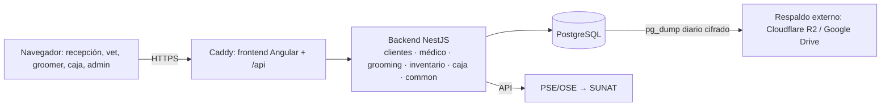

# Plan de desarrollo — Sistema veterinario

> Copia del plan del 27 de octubre de 2026. La versión viva está en https://claude.ai/artifact/Uu4KC76mYuwsoZDqMnzMxt
>
> **Estado:** Fase 0 terminada (pasos 1, 2 y 3). Siguiente: Fase 1, clientes y mascotas.

Construimos el sistema en 8 fases. Cada fase entrega un módulo que ya se puede usar en una clínica real, empezando por los cimientos y terminando en lo comercial. Grooming e inventario farmacéutico entran temprano porque son los de más valor de venta y no dependen del módulo médico.

## 1. Objetivo

- **Qué se construye:** un sistema de gestión veterinaria SaaS para clínicas en Perú. Módulos: dashboard, clientes y mascotas, módulo médico (citas, SOAP, recetas, vacunas), grooming, inventario farmacéutico con lotes, y caja con boletas y facturas.
- **Quién lo usa:** recepción, veterinarios, bañadores y peluqueros, cajeros y el administrador de la clínica. Cada uno ve solo lo que le toca según su rol.
- **Qué se espera al final:** un producto vendible a clínicas y, al mismo tiempo, un proyecto de portafolio que muestre dominio full-stack.
- **Restricciones:** Angular 22 + Tailwind CSS (sin Bootstrap ni librerías de componentes pesadas), NestJS en el backend, servicios `.service.ts` separados de los componentes, Reactive Forms con validaciones, y cobro con QR de Yape sin pasarela de pago.
- **Equipo:** un solo desarrollador. Por eso el orden de las fases importa más que la cantidad de funciones.

## 2. Tecnologías recomendadas

Recomiendo Angular 22 + Tailwind 4 en el frontend y NestJS + Prisma + PostgreSQL en el backend: todo en TypeScript, en un solo repositorio con Docker. Es el mismo stack de tu ERP Mayorista, así que reutilizas lo que ya resolviste (multi-tenant, kardex, facturación) y avanzas más rápido trabajando solo. Spring Boot quedó descartado: es más lento de construir para una persona y pide el doble de memoria en el servidor.

| Capa | Recomendado | Por qué |
| --- | --- | --- |
| Frontend | Angular 22 (standalone, signals, sin zone.js) | Las versiones nuevas son más simples y rápidas que la estructura antigua de módulos |
| Estilos | Tailwind CSS 4 + fuentes con @fontsource | Diseño propio sin Bootstrap; las fuentes viven dentro del proyecto |
| Interacciones | Angular CDK (drag and drop, overlays) | Oficial y liviano: sirve para el Kanban de grooming y los modales |
| Formularios | Reactive Forms | Validaciones claras (DNI de 8 dígitos, RUC de 11) |
| Gráficos | Chart.js | Liviano y suficiente para los KPIs del dashboard |
| Iconos | Lucide (registro local de SVG) | Sin dependencia extra; ya está armado |
| Backend | NestJS 12 sobre Node 24 LTS (TypeScript) | Un solo lenguaje en todo el proyecto, el mismo de tu ERP Mayorista, y poca memoria en el servidor |
| Datos | PostgreSQL + Prisma 7 | Transacciones con bloqueo de filas (`SELECT … FOR UPDATE`) para el stock FEFO |
| Migraciones | Prisma Migrate | Cada cambio de la base de datos queda versionado en el repo |
| API | DTOs con class-validator + Swagger (@nestjs/swagger) | Validación en el servidor y documentación para probar |
| Seguridad | JWT con roles (guards de NestJS) y contraseñas con bcrypt | Roles: admin, veterinario, recepción, groomer y cajero |
| Tiempo real | Consulta periódica primero; luego Server-Sent Events | El Kanban se actualiza sin agregar WebSockets desde el inicio |
| Pruebas | Pruebas unitarias + PostgreSQL real para FEFO · Vitest en Angular · Playwright | FEFO probado contra la base real; flujos completos de punta a punta |
| Infraestructura | Docker Compose + GitHub Actions | Mismo entorno en tu PC y en el servidor; pruebas automáticas en cada push |
| Despliegue | Un VPS económico (Contabo o Hostinger) de US$ 6–7 al mes con todo dentro | Suficiente para una clínica pequeña; Lightsail cuando haya varias |
| Comprobantes | Impresión de ticket con CSS desde el navegador; boleta y factura electrónicas por un PSE/OSE | Funciona sin impresora especial; SUNAT se integra por API en la Fase 4 |

Evita Angular Material y Bootstrap (pelean con Tailwind) y los `NgModule` nuevos.

### Despliegue para una veterinaria pequeña

Para la primera clínica basta un VPS económico de unos US$ 6–7 al mes, con todo adentro y un respaldo diario fuera del servidor. Cuando haya varias clínicas pagando, se pasa a Lightsail o a un plan más grande.

- **Servidor:** [Contabo Cloud VPS 10](https://www.whtop.com/plans/contabo.com/133001) (3 vCPU, 75 GB NVMe; €4.40 al mes el primer periodo y €5.50 al renovar, según [cambios de 2026](https://pricingsaas.com/companies/contabo.main/diffs/2026Q2)) o [Hostinger KVM 1](https://www.vpsbenchmarks.com/hosters/hostinger/plans/kvm-1) (4 GB de RAM; US$ 6.99 al mes el primer año con contrato anual, luego unos US$ 12.99). Hostinger tiene panel y soporte en español; Contabo sale más barato al renovar.
- **Dentro del servidor (Docker Compose):** PostgreSQL, el backend NestJS (unos 200 MB de memoria) y Caddy. Caddy sirve el frontend compilado, redirige `/api` al backend y renueva el certificado HTTPS solo, gratis.
- **Respaldo externo, obligatorio:** un `pg_dump` diario cifrado se copia a Cloudflare R2 o Google Drive y se guardan 30 días. Una vez al mes se prueba restaurar. Los VPS baratos no garantizan sus propias copias.
- **Monitoreo:** un chequeo gratuito de disponibilidad (por ejemplo, UptimeRobot) que te avisa si el sistema se cae, antes de que llame la clínica.
- **Dominio:** un `.com`, aproximadamente US$ 10–15 al año.
- **Internet de la clínica:** si se cae el internet, se cae el sistema. Lo práctico es tener un respaldo con datos móviles (un router 4G o el celular como punto de acceso).

| Opción | Costo mensual aprox. | Cuándo usarla |
| --- | --- | --- |
| Contabo Cloud VPS 10 | €4.40–5.50 | Primera clínica, al menor costo a largo plazo |
| Hostinger KVM 1 | US$ 6.99 el primer año, ~US$ 12.99 después | Si prefieres panel y soporte en español |
| AWS Lightsail 2 GB | US$ 12 + ~US$ 3 de snapshots | Varias clínicas, o cuando la estabilidad pesa más que el precio |
| Oracle Always Free | Gratis | Solo demo y portafolio: en junio de 2026 [redujo sus límites](https://infoq.com/news/2026/07/oracle-cloud-free-tier-limits/) sin aviso |

No uses planes gratuitos para una clínica en uso. Un servidor dentro de la clínica ahorra la mensualidad, pero te deja a cargo de apagones, robos y respaldos. Cobra a la clínica una mensualidad que cubra el servidor y tu soporte.

## 3. Decisiones y supuestos

Las tres decisiones de fondo ya están tomadas.

**Decisiones**

1. **Proyecto (resuelta):** repositorio nuevo, UywaSys, en `H:\uywasys`, con `frontend/` y `backend/`. No se reutiliza código de Petclinic. Nombre comercial: Uywa.
2. **Comprobantes electrónicos (resuelta):** sí, desde el primer día. La mayoría de contribuyentes está obligada y una nota de venta no es un comprobante válido, así que la integración con un PSE/OSE entra en la Fase 4.
3. **Una o varias clínicas (resuelta):** base preparada para varias. Cada tabla lleva `clinic_id` desde el inicio, aunque se empiece con una sola clínica.

**Supuestos** (se corrigen si no aplican)

- [Supuesto] Una clínica con una sede al inicio, pero las tablas llevan `clinic_id` para no cerrar la puerta a varias.
- [Supuesto] Base de datos PostgreSQL y zona horaria America/Lima para todas las fechas.
- [Supuesto] Yape se cobra con el QR fijo de la clínica: el cajero confirma el pago en su app y registra el código de operación. Sin una pasarela no existe confirmación automática.

**Cambios que propongo a la especificación de grooming e inventario**

- `groomerName` como texto pasa a ser un empleado (`Staff`) con su porcentaje de comisión. Con texto libre, "José" y "jose" serían dos personas distintas al calcular comisiones.
- `paid` deja de ser un sí/no que se marca a mano: se calcula a partir de la venta en caja vinculada al servicio.
- Se agrega una tabla de movimientos de stock (kardex). Sin ella no se sabe qué lote se vendió, a quién ni cuándo, y no se puede anular una venta devolviendo las unidades a su lote.

## 4. Arquitectura

Una aplicación Angular habla con un solo backend NestJS organizado por módulos de negocio, sobre una sola base PostgreSQL. No hacen falta microservicios: un monólito ordenado es más rápido de construir y de desplegar para un solo desarrollador.



Caja, el módulo médico y la merma interna nunca tocan los lotes directamente: siempre llaman a `InventoryService.deductStock`, así la regla FEFO vive en un solo lugar.

**Estructura del repositorio**

```text
uywasys/
├── backend/  (NestJS, un módulo por área de negocio)
│   ├── prisma/          schema.prisma y migraciones
│   └── src/
│       ├── clientes/     module, controller, service, dto
│       ├── medico/
│       ├── grooming/
│       ├── inventario/
│       ├── caja/
│       └── common/       auth, clínica activa (clinic_id), errores, auditoría
├── frontend/ (Angular, una carpeta por módulo con carga diferida)
│   └── src/app/
│       ├── core/         layout, auth, interceptores, modelos
│       ├── shared/       ui (botones, badges, modal, tabla), utils
│       └── features/     dashboard, clientes, medico, grooming, inventario, caja
└── docker-compose.yml   PostgreSQL para desarrollo
```

## 5. Plan por fases

El orden lo marcan las dependencias. Clientes va primero porque todo lo usa. Inventario y grooming van antes de caja porque caja cobra ambos. El módulo médico necesita inventario para sus recetas. El dashboard va al final porque resume a todos los demás.

| Fase | Qué entrega | Condición para pasar |
| --- | --- | --- |
| **0. Cimientos** | Repo, Docker Compose, PostgreSQL, Prisma y GitHub Actions. Login con roles, usuarios, configuración de la clínica y bitácora | El login funciona y se despliega en un servidor de prueba |
| **1. Clientes y mascotas** | Clientes con DNI/RUC, mascotas con raza, sexo y alergias. Ficha, cola del día con urgencias e importación desde Excel | Recepción registra cliente y mascota en menos de 1 minuto |
| **2. Inventario farmacéutico** | Productos, lotes, presentaciones, kardex y conteo físico. FEFO, ingreso de compras, merma y semáforo de vencimientos | Pasan las pruebas FEFO, incluida la de dos ventas simultáneas |
| **3. Grooming** | Check-in con checklist, Kanban por estados y delivery. Botón de WhatsApp y reporte de comisiones por groomer | Un día completo del área de baño se maneja solo con el tablero |
| **4. Caja y ventas** | Cuenta del paciente, boleta y factura electrónica (PSE/OSE). Efectivo y Yape, pagos parciales, caja chica y reporte en Excel | SUNAT acepta las boletas y el cierre de caja cuadra con ventas y egresos |
| **5. Módulo médico** | Agenda de citas, consulta SOAP y recetas que descuentan stock. Vacunas con refuerzo, carnet, adjuntos y consentimientos | Una consulta completa, de la cita a la receta, sin salir del sistema |
| **6. Dashboard y alertas** | KPIs del día, citas de hoy, stock bajo y lotes por vencer. Recordatorios de vacunas con enlace de WhatsApp | Cada número del dashboard coincide con su módulo de origen |
| **7. Comercialización** | Versión 2: hospitalización, compras, gastos y reservas en línea. Demo pública, página de venta y segunda clínica | Primera clínica usando el sistema (fase abierta: crece con los clientes) |

El código de cada fase se entrega en dos partes, backend y luego frontend, y no se pasa a la siguiente fase sin cumplir su condición.

### Lo que una clínica necesita desde el primer día

Sin estas funciones una clínica no puede empezar a usar el sistema, así que entran dentro de las fases y no al final.

| Función | Fase | Por qué no puede faltar |
| --- | --- | --- |
| Configuración de la clínica (nombre, RUC, logo, horarios, precios, series de comprobantes) | 0 | Sale en tickets, boletas, recetas y carnets |
| Gestión de usuarios (alta, baja, cambio y recuperación de contraseña) | 0 | El personal rota; el dueño debe poder quitar accesos solo |
| Bitácora de auditoría (quién anuló, borró o cambió un precio) | 0 | Protege al dueño contra pérdidas internas |
| Consentimiento de datos personales al registrar al cliente | 1 | Lo exige la Ley 29733 |
| Cola del día: quién llegó, quién espera, quién está en consulta, con urgencias primero | 1 | La mayoría llega sin cita |
| Persona autorizada para recoger a la mascota | 1 | A veces recoge alguien que no es el dueño |
| Importar clientes, mascotas y productos desde Excel | 1 y 2 | Nadie va a escribir 500 clientes a mano |
| Conteo físico y ajuste de inventario | 2 | Sin conteos, el stock del sistema deja de ser confiable en semanas |
| Servicios con insumos (la vacunación descuenta el frasco, el baño el champú) | 2 | Se cobra un servicio, pero el stock igual debe bajar |
| Constancia de grooming imprimible | 3 | Respaldo de lo que se recibió y entregó |
| Cuenta del paciente: consulta, grooming y medicamentos quedan como cargos pendientes para caja | 4 | Sin ella, los cobros se avisan de palabra y se pierden |
| Boleta y factura electrónicas por PSE/OSE, notas de crédito y resumen diario | 4 | Obligación de SUNAT desde el primer día |
| Pagos parciales y deuda del cliente | 4 | "Le dejo la mitad y el resto al recoger" es lo normal |
| Egresos de caja chica | 4 | Sin ellos el cierre de caja nunca cuadra |
| Reporte de ventas y caja en Excel | 4 | Lo pide el contador cada mes |
| Receta y carnet de vacunas imprimibles, con la colegiatura del veterinario | 5 | El dueño los guarda y los muestra en otras clínicas |
| Adjuntos en la historia clínica (fotos, análisis, radiografías) | 5 | Sin ellos la historia queda incompleta |
| Consentimientos informados (cirugía, anestesia, eutanasia) para firmar | 5 | Respaldo legal de la clínica |

### Versión 2 y más adelante

- **Versión 2:** hospitalización (solo si la clínica interna mascotas), proveedores y compras, gastos de la clínica para ver la ganancia real, agenda por veterinario, curva de peso y paquetes como el plan de vacunación anual.
- **Más adelante:** recordatorios automáticos por WhatsApp (la API oficial cobra por conversación; mientras tanto, enlaces `wa.me` gratis), reservas en línea, facturación electrónica y varias sedes.

## 6. Diseño de grooming e inventario

Ambos módulos siguen la especificación que enviaste, con los cambios de la sección 3. Las piezas clave son el flujo de estados de grooming y la regla FEFO de inventario.

### Grooming

- **Entidades:** `GroomingSession` (mascota, fecha y hora de ingreso y salida, servicio, precio, estado, checklist y delivery), `GroomingService` (catálogo con precio por tamaño de mascota) y `Staff` (bañador o peluquero, con su % de comisión).
- **Estados:** solo avanzan en este orden: `WAITING` → `BATHING` → `CUTTING` → `READY` → `DELIVERED`. Un servicio "solo uñas" puede saltar de `WAITING` a `READY`. Cualquier otro salto devuelve error 409. Cada cambio guarda su hora, para medir los tiempos reales por servicio.
- **Checklist de recepción:** pulgas, nudos, agresividad, observaciones de piel y pertenencias. Se guarda al hacer el check-in y después no se puede editar, porque es la protección ante reclamos.
- **Kanban:** una columna por estado. En escritorio se arrastra con Angular CDK; en móvil cada tarjeta tiene un botón "Avanzar". Si el cambio falla en el servidor, la tarjeta vuelve a su columna.
- **WhatsApp:** el botón aparece en `READY` y abre `https://wa.me/51{celular}?text=…` con el mensaje codificado. Solo se habilita si el celular del dueño tiene 9 dígitos y empieza con 9.
- **Comisiones:** reporte semanal y mensual por groomer, con la suma de lo cobrado multiplicada por su porcentaje. Solo cuentan los servicios pagados y entregados.

### Inventario farmacéutico

- **Entidades:** `Product`, `ProductBatch` (lote), `ProductPresentation` (presentación de venta) y `StockMovement` (kardex). El stock se guarda siempre en la unidad mínima: pastillas, gramos o mililitros.
- **Regla FEFO (`deductStock`):** dentro de una transacción, bloquea los lotes activos del producto (`SELECT … FOR UPDATE`), ordenados por vencimiento y luego por id, y descuenta de cada uno hasta cubrir lo pedido. Los lotes vencidos no se venden. Si no alcanza, responde 409 con lo disponible y no descuenta nada. Cada lote tocado deja un movimiento en el kardex.
- **`totalStock`:** se actualiza en la misma transacción que los lotes, con `un campo de versión (bloqueo optimista`). Así dos cajas no venden el mismo último blister.
- **Ingreso de compra:** se registra en la presentación en que se compró (por ejemplo, 5 "Caja x 100") y el sistema lo convierte a unidades mínimas.
- **Stock legible:** 347 pastillas se muestran como "3 cajas, 4 blister y 7 pastillas", calculado a partir de las presentaciones.
- **Semáforo de vencimientos:** los días que faltan se calculan en el backend con fecha de Lima. Rojo: vencido o 30 días o menos. Amarillo: de 31 a 60 días. Verde: más de 60.
- **Merma y consumo interno:** descuentan con la misma regla FEFO o de un lote específico (por ejemplo, un frasco roto), siempre con un motivo obligatorio.

### Endpoints

| Método | Ruta | Uso |
| --- | --- | --- |
| POST | `/api/grooming` | Check-in con checklist |
| GET | `/api/grooming?date=` | Tablero del día |
| PATCH | `/api/grooming/{id}/status` | Avanzar de estado |
| GET | `/api/grooming/commissions?from=&to=` | Comisiones por groomer |
| GET / POST | `/api/inventory/products` | Catálogo y alta de productos |
| POST | `/api/inventory/products/{id}/batches` | Ingreso de lote o compra |
| POST | `/api/inventory/products/{id}/deductions` | Merma o consumo interno |
| GET | `/api/inventory/batches/expiring?days=60` | Semáforo de vencimientos |
| GET | `/api/inventory/products/{id}/movements` | Kardex del producto |

### Caja y comprobantes

- **Cuenta del paciente:** cada consulta, servicio de grooming o medicamento aplicado queda como cargo pendiente del cliente. Caja ve la cuenta abierta y cobra todo junto.
- **Una sola boleta para servicios y productos:** cada ítem lleva su tipo, su unidad SUNAT (`ZZ` para servicios; `NIU`, `KGM` o `MLT` para productos) y su código de afectación del IGV (`10` gravado, `20` exonerado, `30` inafecto).
- **Servicios con insumos:** un servicio puede tener productos asociados. Al cobrar "Vacunación séxtuple", el cliente ve una sola línea y el frasco sale del inventario por FEFO.
- **Emisión:** la venta se envía por API al PSE/OSE, que la firma, la informa a SUNAT y devuelve el PDF y el XML. Si el servicio no responde, la venta queda como pendiente de envío y se reintenta, sin frenar la atención.
- **Anulaciones:** nunca se borra una venta emitida. Se anula con comunicación de baja o nota de crédito, y el stock vuelve a su lote.
- **Yape:** cada pago por Yape también lleva su boleta; el código de operación queda guardado en el pago.
- **Caja chica:** los egresos (agua, movilidad, compras menores) se registran con motivo y entran en el cierre.

## 7. Casos límite y riesgos

El riesgo más grande no es técnico sino de alcance: siete módulos para una sola persona. Por eso cada fase termina con algo usable y la Fase 7 queda abierta.

| Riesgo o caso límite | Qué pasa si no se cubre | Cómo lo manejamos |
| --- | --- | --- |
| Dos ventas del último blister al mismo tiempo | Stock negativo | Bloqueo de fila en los lotes + `campo de versión` en el producto |
| Venta que necesita unidades de dos lotes | Se vende de un lote equivocado o falta stock | FEFO recorre los lotes en orden y deja un movimiento por cada lote |
| Venta anulada o devolución | El stock no regresa o vuelve al lote equivocado | El kardex dice de qué lote salió cada unidad y se devuelve ahí |
| Lote vencido todavía con stock | Se vende un medicamento vencido | FEFO lo salta; solo se puede sacar como merma |
| Fechas en UTC en el servidor | Un lote aparece vencido un día antes | Todas las fechas de negocio se calculan con zona America/Lima |
| Celular mal escrito | El enlace de WhatsApp abre un chat vacío | Validación de 9 dígitos al registrar al cliente |
| Cambio de groomer a mitad del servicio | La comisión se asigna a la persona equivocada | La comisión va a quien figura al pasar a `READY`, y el cambio queda registrado |
| Mascota agresiva | Riesgo para el personal | Alerta roja en la tarjeta y en la ficha de la mascota |
| Captura falsa de Yape | Se entrega el servicio sin cobrar | El cajero verifica el código en su app; queda guardado quién lo verificó |
| Comprobantes no electrónicos | Multas de SUNAT por no emitir un comprobante electrónico válido | Boleta y factura electrónicas por PSE/OSE desde la Fase 4; el régimen de cada clínica se valida con su contador |
| Datos personales (DNI, celulares) | Incumplir la ley de protección de datos personales (Ley 29733) | Acceso por roles, contraseñas cifradas y respaldos; revisar los requisitos antes de vender |

## 8. Cumplimiento legal

El sistema ayuda a cumplir, pero la responsable legal es la clínica; tú respondes por tu propio negocio y por cuidar los datos que alojas. Antes de vender, conviene una revisión corta con un contador y un abogado del contrato y la política de privacidad.

| Tema | Qué exige | Cómo lo cubre el sistema | Quién responde |
| --- | --- | --- | --- |
| Comprobantes electrónicos (SUNAT) | Toda venta de bienes o servicios lleva boleta o factura. Hasta S/ 5 se puede consolidar; desde S/ 700 se identifica al cliente. Una boleta no se borra: se da de baja o se emite nota de crédito. Resumen diario en 7 días como máximo | Emite por API de un PSE/OSE desde la caja, con series B001 y F001, notas de crédito, y guarda el XML y el PDF | La clínica emite; tú integras |
| Régimen tributario | Nuevo RUS queda fuera de la obligación electrónica general y, hasta donde sabemos, no emite facturas | Configuración por clínica: qué comprobantes emite y con qué series | Contador de la clínica |
| Registro de ventas | El SIRE obligatorio alcanza por ahora a los principales contribuyentes (más de 2 300 UIT) desde octubre de 2026; a una clínica pequeña se lo pide su contador | Exporta las ventas del mes a Excel con los datos contables | Contador de la clínica |
| Datos personales (Ley 29733 y su reglamento, DS 016-2024-JUS) | Consentimiento previo y expreso; política de privacidad; documento de seguridad con control de accesos y revisión periódica de privilegios; oficial de datos personales; incidentes graves avisados a la autoridad en 48 horas; un servidor fuera del Perú es un flujo transfronterizo | Casilla de consentimiento al registrar al cliente, roles, bitácora, contraseñas cifradas, HTTPS, respaldos, y exportar o borrar los datos de un cliente | La clínica es titular; tú eres encargado, con contrato |
| Libro de reclamaciones (INDECOPI) | Todo local abierto al público lo necesita, físico o virtual; respuesta en 15 días hábiles; multa de hasta 50 UIT | No es obligatorio dentro del sistema; si luego hay reservas en línea, el libro virtual va en la página principal | La clínica |
| Receta y medicamentos veterinarios | La venta de productos veterinarios está regulada por SENASA (DS 015-98-AG); la receta la firma un médico veterinario | La receta imprime el nombre y el número de colegiatura del veterinario; el kardex dice qué lote se vendió y a quién | La clínica; confirmar requisitos con SENASA y el CMVP |
| Consentimientos informados | Firma del dueño antes de cirugía, anestesia o eutanasia | Formato imprimible y copia escaneada adjunta a la historia | La clínica |
| Tu negocio | Cobrar una mensualidad requiere RUC y emitir tu propio comprobante electrónico | Contrato de servicio: los datos son de la clínica, exportación al terminar, respaldos, disponibilidad y límite de responsabilidad | Tú |
| Licencias de software | Proyecto nuevo, sin código de Petclinic; las librerías usadas son MIT, Apache u OFL y permiten uso comercial | Archivo de licencias en el repositorio | Tú |

## 9. Criterios de calidad

Una fase está terminada cuando cumple la lista general y las pruebas de su módulo. Si falta algo de la lista, la fase sigue abierta.

**Lista general (todas las fases)**

- [ ] Compila en modo producción y pasan el linter y las pruebas en GitHub Actions
- [ ] Validaciones en el formulario y también en el backend: el servidor nunca confía solo en Angular
- [ ] Pantallas con estados de carga, vacío y error, y usables desde 360 px de ancho
- [ ] Cada endpoint tiene su rol definido y responde 403 a quien no lo tiene
- [ ] Los cambios de base de datos están en una migración de Prisma

**Pruebas que deben pasar sí o sí**

| Módulo | Prueba | Tipo |
| --- | --- | --- |
| Clientes | Rechaza un DNI de 7 dígitos y un RUC que no empieza con 10 ni con 20 | Unitaria |
| Inventario | FEFO descuenta primero del lote que vence antes y cruza a otro lote si hace falta | Testcontainers |
| Inventario | Sin stock suficiente responde 409 y no descuenta nada | Testcontainers |
| Inventario | Dos ventas simultáneas del último stock: solo una tiene éxito | Testcontainers |
| Inventario | Los límites del semáforo (días 30, 31, 60 y 61) dan el color correcto | Unitaria |
| Grooming | Un salto de estado no permitido devuelve 409 | Unitaria |
| Grooming | Check-in completo en menos de 1 minuto | Playwright |
| Grooming | El enlace de WhatsApp tiene el número y el mensaje correctos | Unitaria |
| Caja | Venta con efectivo más Yape: los montos cuadran y el vuelto es correcto | Playwright |
| Caja | Anular una venta devuelve el stock a sus lotes | Testcontainers |
| Médico | Una consulta firmada ya no se puede editar | Unitaria |

**Antes de entregarlo a una clínica**

- [ ] Se restauró un respaldo real en un servidor limpio, no solo se creó
- [ ] Cada actualización hace un respaldo antes de aplicar las migraciones
- [ ] El login bloquea tras 5 intentos fallidos y las contraseñas se guardan cifradas (BCrypt)
- [ ] Hay una alerta automática si el sistema se cae
- [ ] Manual corto o videos de 2 minutos por rol (recepción, caja, veterinario, groomer)
- [ ] Un mes de prueba con la clínica antes de cobrar la mensualidad completa
- [ ] Aviso de privacidad según la Ley 29733 y un contrato simple de servicio

## 10. Revisión final y siguiente paso

El plan cubre los cinco módulos del alcance original más grooming e inventario con lotes, FEFO y fraccionamiento. También incluye lo que una clínica necesita desde el primer día (configuración, usuarios, importación desde Excel, impresiones, pagos parciales y auditoría), repartido en sus fases. Hospitalización, compras y gastos quedan para la versión 2.

- **Supuestos débiles:** Los puntos de la sección 8 que dependen de cada clínica (régimen tributario, SENASA y colegiatura). Se confirman con el contador y un abogado antes de vender, no después.
- **Cambio frente al pedido original:** el dashboard se diseña en la Fase 0 pero se llena al final, porque sus KPIs dependen de los demás módulos.
- **Entrega del código:** por fase y por capas, como pediste. Primero el backend de la fase, luego su frontend, cada parte probada antes de pasar a la siguiente.

**Siguiente paso:** la Fase 0 está en marcha en `H:\uywasys`. Si conoces una clínica, pasa un día ahí antes de la Fase 1: observa recepción, consulta y cobro, y pregunta qué anotan todavía en cuaderno.

## Fuentes

- [Amazon Lightsail: precios](https://aws.amazon.com/lightsail/pricing), consultado el 27 de octubre de 2026
- [Precios de Hetzner Cloud en 2026](https://www.bitdoze.com/es/hetzner-cloud-precios-2026/) (por qué se descartó: los planes baratos son solo de Europa y no se pueden pedir)
- [Contabo: cambios de precio 2026](https://pricingsaas.com/companies/contabo.main/diffs/2026Q2) y [Contabo Cloud VPS 10](https://www.whtop.com/plans/contabo.com/133001)
- [Hostinger KVM 1 (VPSBenchmarks)](https://www.vpsbenchmarks.com/hosters/hostinger/plans/kvm-1)
- [Oracle Always Free: límites 2026 (InfoQ)](https://infoq.com/news/2026/07/oracle-cloud-free-tier-limits/)
- [SUNAT: boleta de venta electrónica](https://cpe.sunat.gob.pe/tipos_de_comprobantes/boleta) y [obligados a emitir comprobantes electrónicos](https://cpe.sunat.gob.pe/informacion_general/obligados_cpe)
- [El Peruano: SUNAT extiende el plazo del SIRE](https://www.elperuano.pe/noticia/299237-sunat-extiende-plazo-del-sire-para-empresas-con-ingresos-superiores-a-2300-uit)
- [La Cámara: nuevo reglamento de protección de datos personales](https://lacamara.pe/nuevo-reglamento-refuerza-la-proteccion-de-datos-personales/)
- [Gestión: Libro de Reclamaciones](https://gestion.pe/economia/libro-de-reclamaciones-todo-lo-que-deberia-saber-a-la-hora-de-solicitarlo-indecopi-consumidores-derecho-de-consumidores-reclamos-noticia/)
- [DS 015-98-AG: productos de uso veterinario (AMPEID)](https://ampeid.org/documents/peru/regulations-for-registration-control-and-marketing-of-products-for-veterinary-use-and-animal-feed/)
